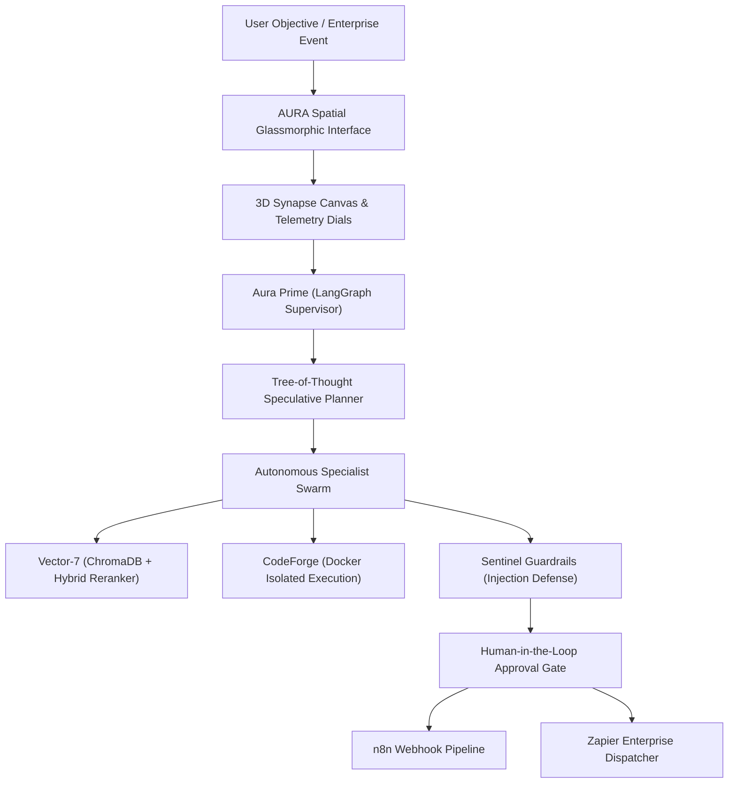

# AURA // NEXUS: Autonomous Spatial Agentic OS & Enterprise Automation Hub

[](https://opensource.org/licenses/MIT)
[](https://fastapi.tiangolo.com)
[](https://www.docker.com)
[](https://n8n.io)
[](https://langchain-ai.github.io/langgraph/)

**Repository**: [github.com/LuminaQuest/aura-nexus](https://github.com/LuminaQuest/aura-nexus)  
**Author**: **Gaddam Sasikala** — *AI Engineer | Agentic Systems & RAG | Automation | UI/UX*

---

## ⚡ Executive Overview

**AURA // NEXUS** is an **Autonomous Spatial Agentic Operating System and Enterprise Automation Hub**. Designed to bridge high-level AI research and real-world production engineering, it unifies:
1. **Spline-Grade 3D Interactive Synapse Canvas**: Orbiting specialist agent nodes with real-time traveling photon energy pulses and mouse parallax depth.
2. **Holographic Tree-of-Thought (ToT) Speculative Planner**: Real-time multi-branch reasoning with confidence scoring and dynamic pruning.
3. **Bi-Directional Enterprise Automation Fabric**: Native integration with **n8n webhooks**, **Zapier REST events**, and the **Model Context Protocol (MCP)**.
4. **Safety & Human-in-the-Loop (HITL) Sentinel**: Input/output guardrails with adversarial injection defense and interactive modal approvals before irreversible actions.
5. **Dynamic 4-Palette Theme Engine**: Instantly switchable between Aura Amber, Obsidian Cyan, Cyber Lotus, and Matrix Emerald with pure Web Audio API sound synthesis.

---

## 🏗️ Architecture



---

## 🚀 Live Interactive Demo
Open `index.html` in any modern browser or host on GitHub Pages:
```bash
# Run locally with Python
python -m http.server 8080
```
Visit `http://localhost:8080` to experience the live 3D canvas and test multi-agent scenarios.

---

## 👤 Author & Contact
* **Gaddam Sasikala**
* GitHub: [github.com/LuminaQuest](https://github.com/LuminaQuest)
* LinkedIn: [linkedin.com/in/gaddam-sasikala-bb1b13326](https://linkedin.com/in/gaddam-sasikala-bb1b13326)
* Email: [sasikala.gaddam24@sasi.ac.in](mailto:sasikala.gaddam24@sasi.ac.in)
